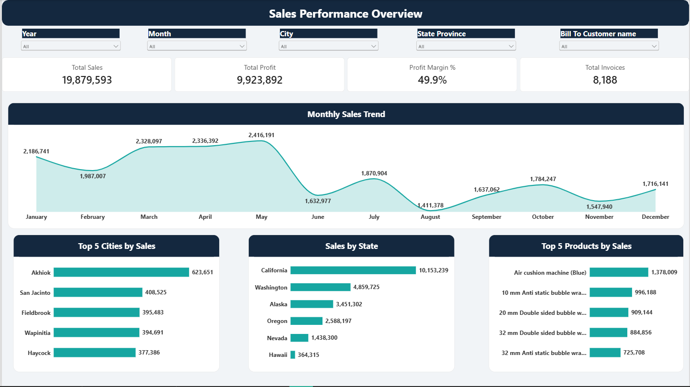
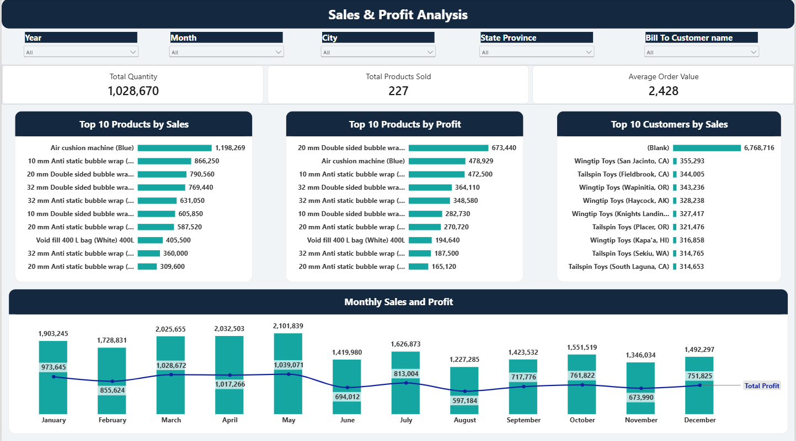
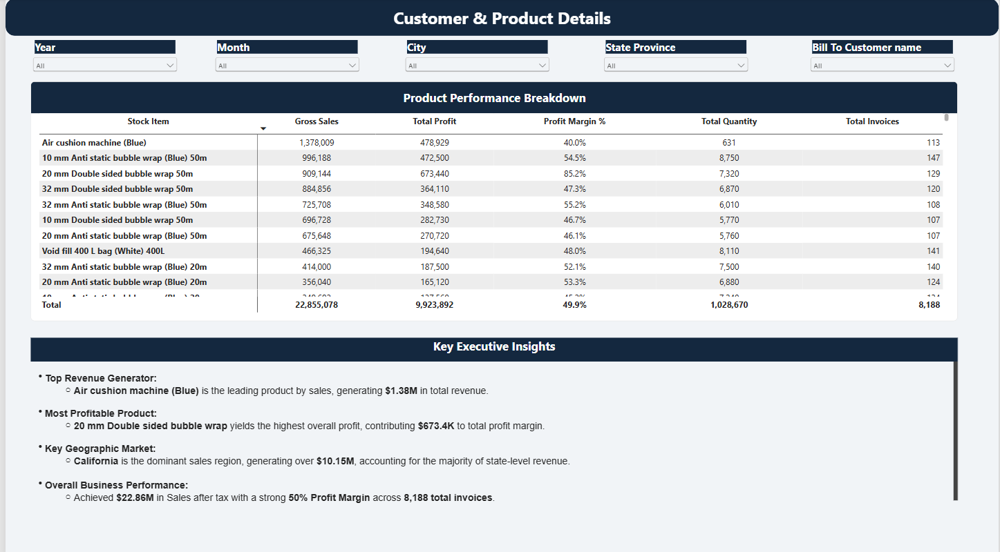
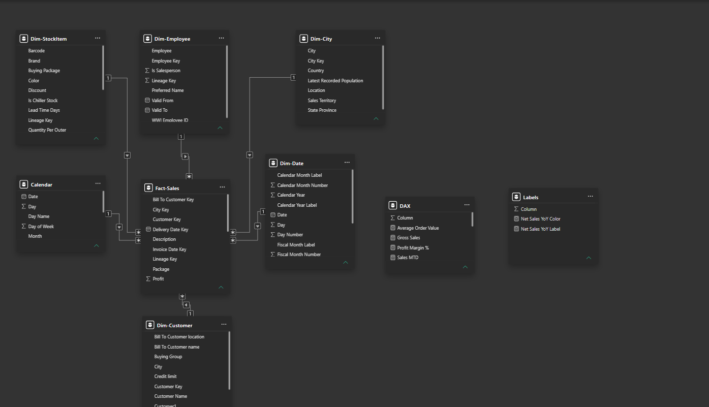

<div align="center">


# ✦ Sales Performance Dashboard ✦

**Power BI Project | 3-page executive report**

*Which products, places and customers drive revenue and profit?*


</div>

* * *

<div align="center">

## ✦ THE QUESTION ✦

</div>

A sales manager wants a quick answer to four questions:

1. How much did we sell, how much profit did we make, and how healthy is the margin?
2. How do sales move across the months?
3. Which **cities, states and products** bring the most revenue and profit?
4. Which **customers** matter most?

> Course project. The data is the Wide World Importers sample dataset.

* * *

<div align="center">

## ✦ DASHBOARD ✦

</div>

**Page 1 · Executive Overview**



**Page 2 · Sales & Profit Analysis**



**Page 3 · Customer & Product Details**



Every page has slicers for **Year, Month, City, State Province and Bill To Customer name**.

* * *

<div align="center">

## ✦ KEY FINDINGS ✦

| Sales (incl. tax) | Sales (excl. tax) | Total Profit | Profit Margin | Total Invoices |
|:---:|:---:|:---:|:---:|:---:|
| 22.86M | 19.88M | 9.92M | 50% | 8,188 |

*Profit margin = profit ÷ sales excluding tax.*

</div>

- **Top revenue product:** *Air cushion machine (Blue)* with **$1.38M** (incl. tax).
- **Most profitable product:** *20 mm Double sided bubble wrap* with **$673.4K** profit.
- **Top market:** **California** leads with **$10.15M** (incl. tax), followed by Washington ($4.86M) and Alaska ($3.45M).
- **Seasonality:** monthly sales peak in **May ($2.42M)** and fall to a low in **August ($1.41M)**.
- **Top cities:** Akhiok ($623.7K), San Jacinto ($408.5K) and Fieldbrook ($395.5K).
- **Product range:** 227 products sold and 1.03M units in total.

* * *

<div align="center">

## ✦ DATA MODEL ✦

</div>

A star schema: one fact table (**Fact-Sales**) connected to dimension tables for products, employees, cities, customers and dates.



Details: [`docs/data-model.md`](docs/data-model.md) · All measures: [`docs/dax-measures.md`](docs/dax-measures.md)

* * *

<div align="center">

## ✦ PROJECT UNIVERSE ✦

</div>

```
sales-performance-dashboard/
├── powerbi/
│   └── Sales_Performance_Dashboard.pbix   # the full report
├── docs/
│   ├── data-model.md                      # tables and relationships
│   └── dax-measures.md                    # measures and their meaning
└── images/                                # dashboard and model screenshots
```

Open the report with [Power BI Desktop](https://powerbi.microsoft.com/desktop/).

* * *

<div align="center">

## ✦ HOW IT WAS BUILT ✦

</div>

| Step | What happened |
|:---|:---|
| ✦ **Model** | Connected the fact table to the dimensions in a star schema |
| ✦ **Measure** | Wrote 17 DAX measures for sales (with and without tax), profit, margin, quantity, invoices, customers and time comparisons (MTD, YTD, previous month, previous year) |
| ✦ **Design** | Dark-navy headers, one teal accent colour and the same five slicers on every page |
| ✦ **Tell the story** | *Overview* → *What drives profit?* → *Details and insights* |

* * *

<div align="center">

## ✦ A LITTLE CURIOSITY GOES A LONG WAY ✦

**One insight at a time.**

[](https://www.linkedin.com/in/hager-naser/)

*Back to my [little universe](https://github.com/hagernaser622) 🪐*

</div>
