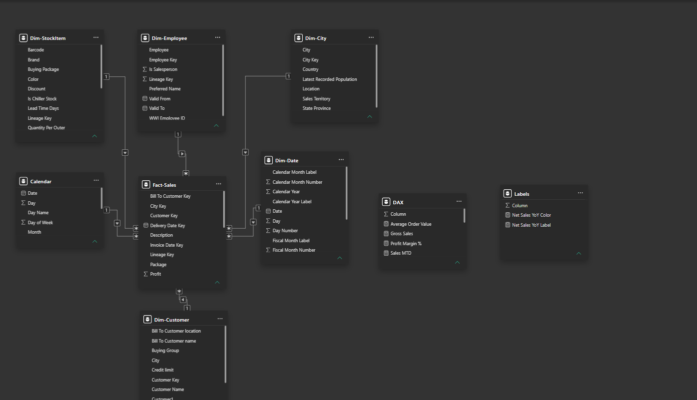

# Data model

The report uses a **star schema**. `Fact-Sales` is the center, and each dimension table filters it (one-to-many).

| Table | Role | Examples of fields |
|:---|:---|:---|
| **Fact-Sales** | Fact table: one row per invoice line | Bill To Customer Key, City Key, Customer Key, Delivery Date Key, Invoice Date Key, Description, Package, Profit |
| **Dim-StockItem** | Products | Barcode, Brand, Buying Package, Color, Discount, Is Chiller Stock, Lead Time Days, Quantity Per Outer |
| **Dim-Employee** | Employees and salespeople | Employee, Employee Key, Is Salesperson, Preferred Name, Valid From, Valid To, WWI Employee ID |
| **Dim-City** | Geography | City, City Key, Country, Latest Recorded Population, Location, Sales Territory, State Province |
| **Dim-Customer** | Customers | Bill To Customer name, Bill To Customer location, Buying Group, City, Credit limit, Customer Key, Customer Name |
| **Dim-Date** | Date dimension (calendar and fiscal) | Calendar Month Label, Calendar Year, Date, Day, Fiscal Month Label |
| **Calendar** | Second date table | Date, Day, Day Name, Day of Week, Month |
| **DAX** | Holds all the measures (no relationships) | See [`dax-measures.md`](dax-measures.md) |
| **Labels** | Helper table for dynamic labels and colors | Net Sales YoY Color, Net Sales YoY Label |

